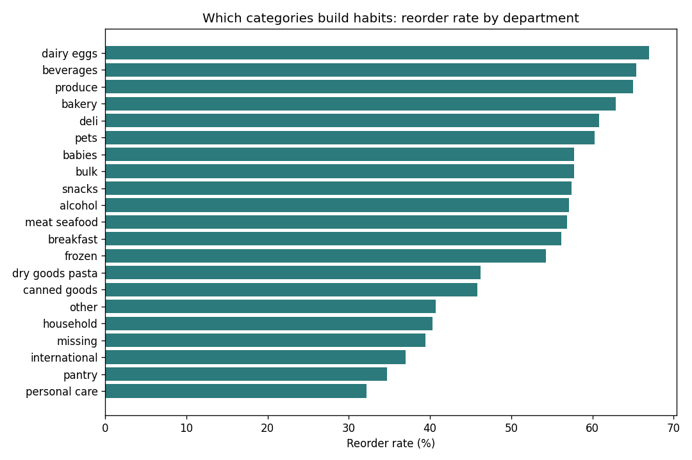

# Quick-Commerce Retention Analysis in SQL

What makes grocery customers come back? Nine SQL analyses on the public **Instacart** dataset
(about 3.4 million orders from about 200,000 customers, with every product in every basket),
focused on the questions a quick-commerce growth or product team asks every week:
which categories build habits, how long the habit window is, how far customers go, how
concentrated the business is, and whether buying across more categories ("width") goes
with stronger retention.



## Key findings
- 3.35M orders from 206K customers; 59% of all items bought were reorders, so grocery is a habit business.
- Fresh and daily categories build habits: dairy & eggs reorder at 67%, beverages and produce at 65%; personal care only 32%.
- The habit window is weekly: 51% of repeat orders come within 7 days, with a spike at exactly 7 days and a second spike at 30+ days (customers drifting away, the win-back moment).
- Retention drops off even among engaged customers (all have 4+ orders): 52% reach order 10, 26% reach 20, 5% reach 50.
- Concentration: the top 20% of customers place 53% of orders.
- Width and retention move together: customers whose first order spanned 7+ departments reached 10 orders more often (54% vs 47% for one department). This is correlation, not proof; the test would be a first-order nudge to add an item from a new category, against a control group.
- Habit products are milk: the top five reordered products are all milk (85-86% reorder rate).

## The questions and the SQL
| # | Question | File | Techniques |
| --- | --- | --- | --- |
| 1 | How big is the business, and how much is repeat buying? | `sql/01_overview.sql` | aggregates, CTE |
| 2 | Which categories build habits? | `sql/02_reorder_by_department.sql` | JOINs, GROUP BY, `SUM() OVER ()` |
| 3 | How long is the habit window between orders? | `sql/03_habit_window.sql` | distribution, running window sum |
| 4 | What share of customers reach their 2nd, 5th, 10th... order? | `sql/04_retention_curve.sql` | `UNNEST`, `FILTER`, CROSS JOIN |
| 5 | How concentrated are orders among the most loyal customers? | `sql/05_concentration.sql` | `NTILE`, cumulative share |
| 6 | Do customers who buy across more categories first time come back more? | `sql/06_breadth_vs_retention.sql` | CTEs, `COUNT(DISTINCT)`, `MEDIAN` |
| 7 | Does first-basket size predict loyalty? | `sql/07_first_basket.sql` | CASE bucketing |
| 8 | Which products are habits? | `sql/08_habit_products.sql` | `HAVING`, `ROW_NUMBER() OVER (PARTITION BY ...)` |
| 9 | When do people order? | `sql/09_when_people_shop.sql` | GROUP BY, heatmap |

## Reading the results honestly
- **Correlation, not causation (Q6, Q7).** Customers with wider or bigger first baskets may simply be more committed
  households. The way to know is an experiment, for example nudging first-time buyers to add one item from a new
  category and comparing repeat rates against a control group.
- **Survivorship (Q4).** Instacart only includes customers with at least 4 orders, so the curve shows how deep engaged
  customers go, not first-order-to-repeat conversion.
- **No calendar dates.** The data has order sequence and days between orders (capped at 30), not dates, so retention is
  measured in orders rather than weeks, and "30" means "30 days or more".

## Run it yourself
```bash
pip install -r requirements.txt
pytest -q                                   # every SQL file tested on a hand-checked mini dataset
python scripts/make_sample_data.py          # optional: fake data to test the pipeline (delete afterwards)
python run_analysis.py --reload             # real data: put the 6 Instacart CSVs in data/ first
```
Outputs: `results/summary.md` (key numbers), `results/*.csv` (every query's table), `charts/*.png`.

## Data
"Instacart Market Basket Analysis" on Kaggle (released by Instacart, 2017). The CSVs are not committed (too large).
SQL runs on DuckDB using PostgreSQL-style syntax.
